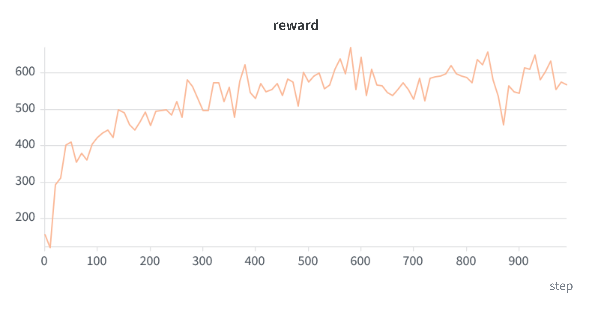
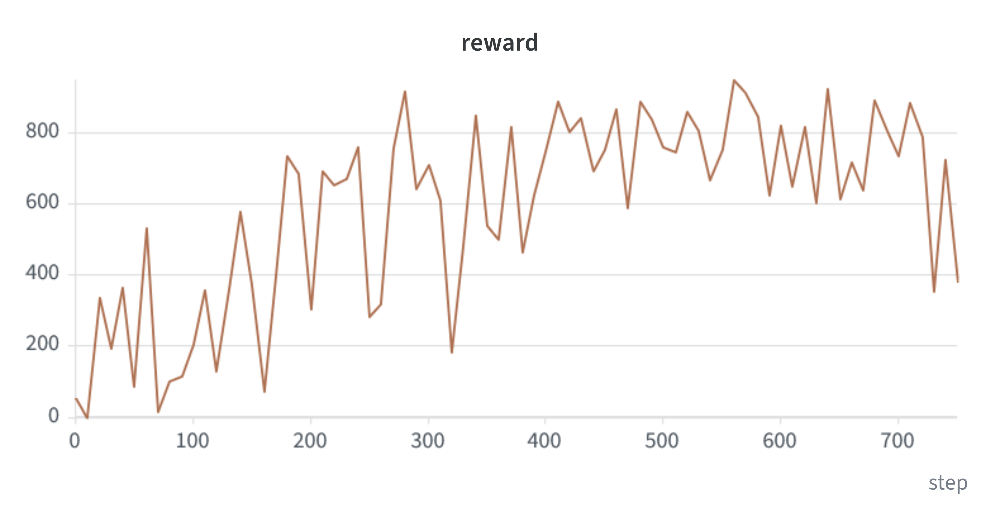

# PlaNet — Learning Latent Dynamics for Planning from Pixels

This project is a PyTorch implementation of [PlaNet](https://arxiv.org/abs/1811.04551) introduced by Danijar Hafner, Timothy Lillicrap, Ian Fischer, Ruben Villegas, David Ha, Honglak Lee, and James Davidson in *Learning Latent Dynamics for Planning from Pixels*.

PlaNet is a model-based reinforcement learning agent that learns environment dynamics directly from images and uses fast online planning in latent space to choose its actions. Its latent dynamics model (a recurrent state-space model) combines a deterministic component with a stochastic component to predict how the environment evolves. Planning in latent space is done using the cross-entropy method (CEM) which searches for the best action sequence under the model.

This implementation learns from 64 × 64 RGB image observations in the DeepMind Control Suite. Training alternates between fitting the model using stored trajectories and collecting new ones with the model. The loss combines reconstruction, reward prediction, and KL regularization. The paper's multi-step latent overshooting objective is not implemented here.

## Training

### Setup

This implementation uses Python 3.11 with CUDA 12.8 and uv. Dependencies can be installed by running the following command:

```bash
uv sync
```

Checkpoints are saved locally and automatically uploaded to Hugging Face. You can authenticate to Hugging Face using:

```bash
hf auth login
```

In the commands below, replace `YOUR_HF_USERNAME/planet` with a HF repository of your choosing.
This implementation uses environments from the [DeepMind Control Suite](https://arxiv.org/abs/1801.00690), a collection of continuous control tasks powered by MuJoCo. The examples below train on the CartPole swing-up and Ball-in-Cup environments.

### CartPole swing-up

```bash
uv run python main.py \
  --domain_name cartpole \
  --task_name swingup \
  --action_dim 1 \
  --run_id 1 \
  --n_steps 1000 \
  --hf_repo_id YOUR_HF_USERNAME/planet
```

### Ball-in-Cup catch

```bash
uv run python main.py \
  --domain_name ball_in_cup \
  --task_name catch \
  --action_dim 2 \
  --run_id 2 \
  --n_steps 1000 \
  --hf_repo_id YOUR_HF_USERNAME/planet
```

The action dimension must match the environment: CartPole uses one control input, and Ball-in-Cup uses two.

### Configuration and logging

A default run starts with five random episodes. Each training iteration performs 100 model updates, then collects one new episode using the planner. Both commands above use the default action repeat of 8.

| Option | Default | Meaning |
| --- | --- | --- |
| `--n_steps` | `1000` | Number of training iterations |
| `--n_update_steps` | `100` | Number of model updates per iteration |
| `--batch_size` | `50` | Batch size |
| `--train_seq_len` | `50` | length of the training sequences |
| `--T` | `1000` | Target number of environment steps per trajectory |
| `--n_action_repeat` | `8` | Number of environment steps for which each action is held |
| `--horizon_len` | `12` | Planning horizon in CEM |
| `--n_candidate_samples` | `1000` | Number of candidate action sequences per CEM iteration |
| `--K` | `100` | Number of candidates retained by CEM |
| `--n_optimization_steps` | `10` | Number of CEM iterations |
| `--save_interval` | `50` | Checkpointing interval |

Logs are written to `logs/train_<run_id>.log`. To also track metrics in Weights & Biases, use the wandb option`--setup_wandb` when running main.py.

Checkpoints contain the model weights, optimizer state, collected trajectories, and training metrics. 

For example, to resume the CartPole example from an existing local checkpoint at step 500, use the following command:

```bash
uv run python main.py \
  --domain_name cartpole \
  --task_name swingup \
  --action_dim 1 \
  --run_id 1 \
  --resume \
  --step_to_load 500 \
  --n_steps 1000 \
  --hf_repo_id YOUR_HF_USERNAME/planet
```

Resuming loads the local checkpoint, it does not download one from Hugging Face. If the original run used Weights & Biases, include `--setup_wandb` to resume its tracking session.

## Results

This part showcases results corresponding to models trained in the cartpole-swingup and ball-in-cup environments. For each environment, we display the training reward curve and a recorded trajectory where the model acts in the environment. The x axis corresponds to the number of training iterations and the y axis shows the mean reward over the five most recent collected trajectories.

### CartPole swing-up

The task is to swing the pole upward and balance it by moving the cart.

<table width="100%">
  <tr>
    <th width="50%">Training reward</th>
    <th width="50%">CartPole trajectory</th>
  </tr>
  <tr>
    <td align="center" valign="middle">
      
    </td>
    <td align="center" valign="middle">
      <video src="https://github.com/user-attachments/assets/fcb438b7-f9cd-4893-8602-43b17a8feb49" controls muted loop playsinline preload="metadata" width="320" aria-label="CartPole swing-up trajectory"></video>
      <br>
      <a href="https://github.com/user-attachments/assets/fcb438b7-f9cd-4893-8602-43b17a8feb49">Open video</a>
    </td>
  </tr>
</table>

### Ball-in-Cup catch

The agent moves the cup to catch the suspended ball.

<table width="100%">
  <tr>
    <th width="50%">Training reward</th>
    <th width="50%">Ball-in-Cup trajectory</th>
  </tr>
  <tr>
    <td align="center" valign="middle">
      
    </td>
    <td align="center" valign="middle">
      <video src="https://github.com/user-attachments/assets/8e363818-3830-45ad-86d4-14231490d909" controls muted loop playsinline preload="metadata" width="320" aria-label="Ball-in-Cup catch trajectory"></video>
      <br>
      <a href="https://github.com/user-attachments/assets/8e363818-3830-45ad-86d4-14231490d909">Open video</a>
    </td>
  </tr>
</table>


